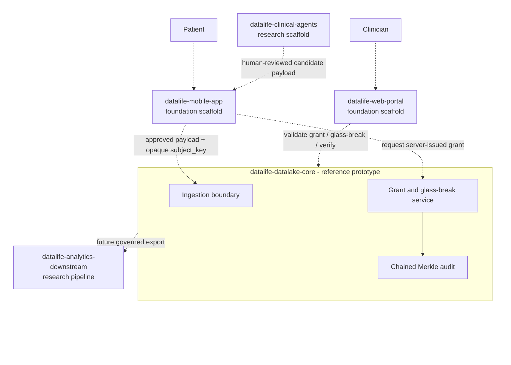

  

<h1 align="center">DataLife e-Health</h1>

  <strong>Patient-sovereign, local-first architecture for privacy-conscious health-data research</strong> 
  Governed contracts 路 Server-authoritative access 路 Reproducible safety evaluation

  
  
  
  

> ### Live Coordination and Sprint Backlog
> Track active tracks, claim ready tasks, and follow community progress in real time:
> **[Open the DataLife v0.1 Projects and Roadmap](https://github.com/orgs/datalife-ehealth/projects)**
>
> The board-specific URL is pending GitHub Project API access for this maintenance
> update. The organization Projects page is the verified public gateway until that
> URL is available.

  <a href="#current-reality">Current reality</a> 路
  <a href="#repository-matrix">Repository matrix</a> 路
  <a href="#contribution-tracks">Contribution tracks</a> 路
  <a href="#onboarding">Onboarding</a> 路
  <a href="#guardrails">Guardrails</a>

---

## Mission

DataLife explores open, privacy-conscious architecture that separates who a person
is from the clinical observations used in care and research. The patient-controlled
tier keeps direct identity data and the identity-to-subject mapping local. Service
components accept only governed, opaque subject keys and approved payloads.

DataLife repositories are reference software, research scaffolds, and policy aids.
They are not a certified EHR, medical device, diagnostic service, treatment system,
or emergency-response platform.

## System architecture

Dashed edges are planned integration boundaries; they are not claims that the
peripheral applications already exist. The core currently has no authorized
clinical-record retrieval or bulk analytics export API. The blank lower margin is
intentional so GitHub's Mermaid viewer controls do not cover a repository or core
component.

### Normal access flow

The core prototype can issue a time-bounded grant for an opaque subject and intended
physician, then validate that grant for a clinician-side client. The server remains
authoritative for validity and expiry; peripheral clients cannot self-authorize.

### Emergency access flow

The glass-break prototype checks a configured physician identifier, requires a
reason, appends an `UNCONFIRMED` event to the Merkle chain, and returns a short-lived
grant. It does **not** yet provide record retrieval, patient ratification/dispute,
durable audit persistence, or a production physician-identity system.

## Architectural invariants

Implementations may evolve, but these constraints do not change without an explicit
RFC and threat-model review:

- **Patient sovereignty.** Names, government identifiers, phone numbers, email
  addresses, emergency contacts, and identity mappings stay in the patient-
  controlled tier.
- **Zero-cloud PII.** Central services must not accept, retain, log, or replicate
  direct identity records. An opaque `subject_key` is still sensitive pseudonymous
  data, not anonymous or public data.
- **Server-authoritative access.** The core issues and validates ephemeral grants. A
  mobile app, web UI, model, or analytics job cannot grant itself access.
- **Tamper evidence, not blockchain.** Audit events use chained SHA-256 Merkle roots
  inside one administrative boundary. There is no token, miner, gas fee, consensus
  protocol, or peer-to-peer ledger.
- **Human authority over automation.** Agent output is untrusted and requires typed
  boundaries, deterministic validation, safe abstention, and human review before an
  external write.
- **Local-first and vendor-neutral.** The default development and test path must not
  require a paid API or proprietary EHR/cloud dependency.
- **Synthetic data by default.** Source, tests, issues, screenshots, demos, and
  research fixtures must not contain real patient information.

## Current reality

### Analytics and ML reality

`datalife-analytics-downstream` now contains the landed v0.1.0 leakage-safe baseline
pipeline from PR #7. It validates the synthetic contract before fitting, uses
train-only median imputation, isolates subjects across splits, and checks forward
time leakage both in memory and against source tables before the ridge-logistic fit.
The output includes a naive prevalence comparator, lineage, limitations, and
reproducible metrics. The next scoped tasks are [#8 subject-stratified K-fold
validation](https://github.com/datalife-ehealth/datalife-analytics-downstream/issues/8)
and [#9 baseline-diff regression checks](https://github.com/datalife-ehealth/datalife-analytics-downstream/issues/9).

### Core and safety

`datalife-datalake-core` is the runnable Python/FastAPI reference prototype for
strict parsing, contextual PII rejection, server-issued grants, glass-break policy,
and chained Merkle verification. SQLAlchemy models and PostgreSQL deployment
configuration exist, but durable runtime persistence and governed bulk export are
not complete. The next tasks are [#12 bounded expiry-aware access-grant
storage](https://github.com/datalife-ehealth/datalife-datalake-core/issues/12) and
[#13 a versioned read-only analytics export
contract](https://github.com/datalife-ehealth/datalife-datalake-core/issues/13).

`datalife-clinical-agents` remains a research scaffold. Draft PR #6 proposes a
standard-library Unicode policy helper using NFKC normalization, case folding, a
narrow U+200B removal rule, bounded inputs, and exceptions that do not echo text;
it is not a merged agent runtime. The next safety tasks are [#7 the deny-by-default
typed tool envelope](https://github.com/datalife-ehealth/datalife-clinical-agents/issues/7)
and [#8 the redacted execution-trace
contract](https://github.com/datalife-ehealth/datalife-clinical-agents/issues/8).

### Web and mobile

`datalife-web-portal` has a landed accessible Next.js shell, but no live clinical
workflow or grant-validation service. [#7](https://github.com/datalife-ehealth/datalife-web-portal/issues/7)
defines the offline security-header baseline; [#8](https://github.com/datalife-ehealth/datalife-web-portal/issues/8)
defines redacted client error states before an API is wired.

`datalife-mobile-app` is framework-neutral and has no application runtime yet. [#6](https://github.com/datalife-ehealth/datalife-mobile-app/issues/6)
scaffolds a vault boundary and offline test gate without choosing Flutter, React
Native, or a platform key implementation.

## Repository matrix

| Repository | Active focus and maturity | Current stack | Roadmap issues |
|---|---|---|---|
| [`datalife-analytics-downstream`](https://github.com/datalife-ehealth/datalife-analytics-downstream) | Implemented synthetic contract, fixture generator, and leakage-safe baseline | Python 3.11+, NumPy, pandas, PyArrow, pytest, Ruff | [#8 K-fold validation](https://github.com/datalife-ehealth/datalife-analytics-downstream/issues/8) (Ready for Work); [#9 baseline diff](https://github.com/datalife-ehealth/datalife-analytics-downstream/issues/9) (Backlog) |
| [`datalife-datalake-core`](https://github.com/datalife-ehealth/datalife-datalake-core) | Runnable reference API; durable persistence and export remain incomplete | Python 3.11+, FastAPI, Pydantic, SQLAlchemy, PostgreSQL target | [#12 grant memory bounds](https://github.com/datalife-ehealth/datalife-datalake-core/issues/12) (Ready for Work); [#13 export contract](https://github.com/datalife-ehealth/datalife-datalake-core/issues/13) (Backlog) |
| [`datalife-web-portal`](https://github.com/datalife-ehealth/datalife-web-portal) | Landed accessible UI shell; workflow integration is not live | TypeScript, React 19, Next.js 15, Vitest | [#7 security headers](https://github.com/datalife-ehealth/datalife-web-portal/issues/7) (Ready for Work); [#8 redacted errors](https://github.com/datalife-ehealth/datalife-web-portal/issues/8) (Backlog) |
| [`datalife-clinical-agents`](https://github.com/datalife-ehealth/datalife-clinical-agents) | Research scaffold with a draft Unicode-policy PR | Python 3.11+ direction; standard-library safety helpers; provider-neutral design | [#7 typed tool envelope](https://github.com/datalife-ehealth/datalife-clinical-agents/issues/7) (Ready for Work); [#8 redacted trace](https://github.com/datalife-ehealth/datalife-clinical-agents/issues/8) (Backlog) |
| [`datalife-mobile-app`](https://github.com/datalife-ehealth/datalife-mobile-app) | Framework-neutral foundation scaffold | Framework pending; offline contract tests first | [#6 vault boundary](https://github.com/datalife-ehealth/datalife-mobile-app/issues/6) (Backlog) |
| [`.github`](https://github.com/datalife-ehealth/.github) | Organization templates, policies, and RFC-first governance | Markdown, GitHub Actions, pinned action revisions | [#1 roadmap metadata](https://github.com/datalife-ehealth/.github/issues/1) (Backlog) |

## Contribution tracks

### Analytics and ML

Work on synthetic longitudinal distributions, subject-level isolation, forward-time
leakage checks, reproducible metrics, calibration, subgroup evaluation, and report
lineage. Analytics remains read-only and must not scrape transactional internals.

### NLP and safety

Work on deterministic Unicode and confusable/control-character policy aids, typed
tool boundaries, redacted execution traces, adversarial fixtures, and human-review
transitions. Model output is untrusted data and cannot grant privileges.

### DevOps and infrastructure

Work on browser security headers, offline CI gates, reproducible development
environments, and the mobile vault boundary. Do not add hidden network calls,
mandatory paid services, or credentials to the default test path.

### Docs and governance

Work on RFC-first workflows, schema/versioning conventions, issue metadata,
contributor onboarding, and cross-repository decision records.

## Onboarding

1. **Find a scoped task.** Open the [DataLife Projects and Roadmap](https://github.com/orgs/datalife-ehealth/projects),
   filter for `Ready for Work`, or choose a `good first issue`.
2. **Align before coding.** Comment on the issue with the approach, observable
   outcome, out-of-scope behavior, and synthetic verification plan. Write
   `I'd like to claim this issue!` only as an expression of interest; a maintainer
   assigns the task explicitly.
3. **Build offline and submit a draft PR.** Branch from `main` using `feat/`,
   `fix/`, `docs/`, `test/`, or `chore/`; link the issue; include exact checks and
   keep the default path credential-free and network-independent.

## Guardrails

- Use synthetic or explicitly licensed de-identified data only. Never put real
  patient information, identity mappings, access grants, or credentials in source,
  issues, screenshots, fixtures, or pull requests.
- Treat opaque subject keys as sensitive pseudonymous data, not anonymous data.
- Keep direct identity fields in the patient-controlled tier. Central services must
  reject, avoid logging, and avoid replicating direct PII.
- Keep server-side authorization authoritative. A mobile app, web UI, model, or
  analytics job cannot self-issue or self-validate access.
- Treat chained Merkle audit evidence as tamper evidence, not a blockchain.
- Keep standard-library or zero-dependency boundaries where a repository requires
  them. Other repositories must pin and document dependencies; tests must run
  offline without credentials or paid APIs.
- These pipelines are research baselines and policy-evaluation aids on synthetic
  longitudinal distributions. They are explicitly **not** clinical diagnoses,
  treatment recommendations, triage, operational healthcare signals, or emergency
  services.

## Community and security

- Scoped technical work belongs in repository Issues and pull requests.
- Cross-project introductions and questions belong in
  [GitHub Discussions](https://github.com/datalife-ehealth/.github/discussions).
- Report vulnerabilities, PII leaks, unsafe agent actions, or exposed credentials
  through [SECURITY.md](https://github.com/datalife-ehealth/.github/blob/main/SECURITY.md),
  never in a public issue.

---

  <em>Open reference architecture for patient sovereignty, auditable access, and reproducible health-data research.</em>

