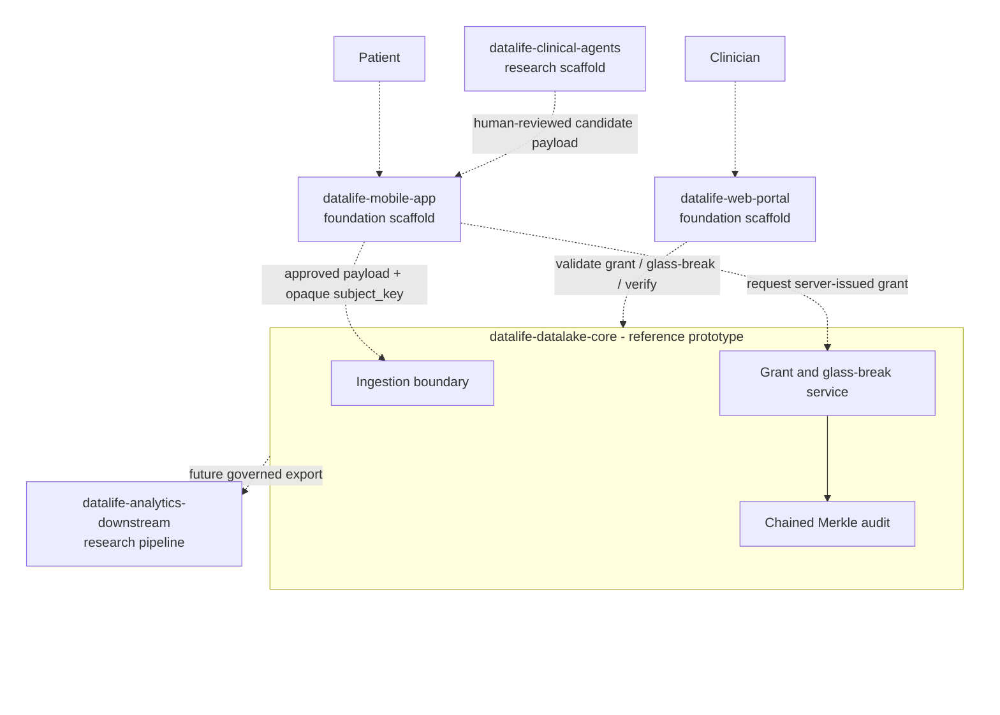

  

<h1 align="center">DataLife e-Health</h1>

  <strong>Patient-sovereign, local-first architecture for privacy-conscious health-data research</strong> 
  Governed contracts | Server-authoritative access | Reproducible safety evaluation

  
  
  
  

## Live Coordination and Sprint Backlog
Track active tracks, claim ready tasks, and follow community progress in real time on our public GitHub Project Board:

👉 **[Open DataLife v0.1 Foundation & Pipelines Roadmap](https://github.com/orgs/datalife-ehealth/projects/1)**

- **Claim & Onboarding Hub**: Milestone 1 RFCs and architecture discussions for each subsystem.
- **Ready for Work**: Immediate Sprint 0.1 priority tasks open for contributors.
- **In Progress**: Active implementations currently underway.
- **Sequential Backlog**: Governed roadmap items sequenced by technical dependencies.

  <a href="#current-reality">Current reality</a> |
  <a href="#repository-matrix">Repository matrix</a> |
  <a href="#contribution-tracks">Contribution tracks</a> |
  <a href="#onboarding">Onboarding</a> |
  <a href="#guardrails">Guardrails</a>

---

## Mission

DataLife explores open, privacy-conscious architecture that separates who a person
is from the clinical observations used in care and research. The patient-controlled
tier keeps direct identity data and the identity-to-subject mapping local. Service
components accept only governed, opaque subject keys and approved payloads.

DataLife repositories are reference software, research scaffolds, and policy aids.
They are not a certified EHR, medical device, diagnostic service, treatment system,
or emergency-response platform.

## System architecture

Dashed edges are planned integration boundaries; they are not claims that the
peripheral applications already exist. The core currently has no authorized
clinical-record retrieval or bulk analytics export API. The blank lower margin is
intentional so GitHub's Mermaid viewer controls do not cover a repository or core
component.

### Normal access flow

The core prototype can issue a time-bounded grant for an opaque subject and intended
physician, then validate that grant for a clinician-side client. The server remains
authoritative for validity and expiry; peripheral clients cannot self-authorize.

### Emergency access flow

The glass-break prototype checks a configured physician identifier, requires a
reason, appends an `UNCONFIRMED` event to the Merkle chain, and returns a short-lived
grant. It does **not** yet provide record retrieval, patient ratification/dispute,
durable audit persistence, or a production physician-identity system.

## Architectural invariants

Implementations may evolve, but these constraints do not change without an explicit
RFC and threat-model review:

- **Patient sovereignty.** Names, government identifiers, phone numbers, email
  addresses, emergency contacts, and identity mappings stay in the patient-
  controlled tier.
- **Zero-cloud PII.** Central services must not accept, retain, log, or replicate
  direct identity records. An opaque `subject_key` is still sensitive pseudonymous
  data, not anonymous or public data.
- **Server-authoritative access.** The core issues and validates ephemeral grants. A
  mobile app, web UI, model, or analytics job cannot grant itself access.
- **Tamper evidence, not blockchain.** Audit events use chained SHA-256 Merkle roots
  inside one administrative boundary. There is no token, miner, gas fee, consensus
  protocol, or peer-to-peer ledger.
- **Human authority over automation.** Agent output is untrusted and requires typed
  boundaries, deterministic validation, safe abstention, and human review before an
  external write.
- **Local-first and vendor-neutral.** The default development and test path must not
  require a paid API or proprietary EHR/cloud dependency.
- **Synthetic data by default.** Source, tests, issues, screenshots, demos, and
  research fixtures must not contain real patient information.

## Current reality

### Analytics and ML reality

`datalife-analytics-downstream` now contains the landed v0.1.0 leakage-safe baseline
pipeline from PR #7. It validates the synthetic contract before fitting, uses
train-only median imputation, isolates subjects across splits, and checks forward
time leakage both in memory and against source tables before the ridge-logistic fit.
The output includes a naive prevalence comparator, lineage, limitations, and
reproducible metrics. Subject-stratified K-fold validation is now merged through
[PR #10](https://github.com/datalife-ehealth/datalife-analytics-downstream/pull/10),
and [PR #11](https://github.com/datalife-ehealth/datalife-analytics-downstream/pull/11)
hardened aggregation helpers against malformed and non-finite inputs. [#9 baseline-diff
regression checks](https://github.com/datalife-ehealth/datalife-analytics-downstream/issues/9)
remains open, alongside the new foundation issues [#12 configurable as-of temporal
windows](https://github.com/datalife-ehealth/datalife-analytics-downstream/issues/12),
[#13 deterministic model benchmark registry](https://github.com/datalife-ehealth/datalife-analytics-downstream/issues/13),
and [#14 calibration and subgroup error diagnostics](https://github.com/datalife-ehealth/datalife-analytics-downstream/issues/14).

### Core and safety

datalife-datalake-core is the runnable Python/FastAPI reference prototype for strict parsing, contextual PII rejection, server-issued grants, glass-break policy, and chained Merkle verification. SQLAlchemy models and PostgreSQL deployment configuration exist, but durable runtime persistence and governed bulk export are not complete. Merged PRs [#6](https://github.com/datalife-ehealth/datalife-datalake-core/pull/6), [#8](https://github.com/datalife-ehealth/datalife-datalake-core/pull/8), [#9](https://github.com/datalife-ehealth/datalife-datalake-core/pull/9), [#10](https://github.com/datalife-ehealth/datalife-datalake-core/pull/10), and [#11](https://github.com/datalife-ehealth/datalife-datalake-core/pull/11) cover concurrency, hardened parsing, PII rejection, cryptographic vectors, and document metadata persistence. PR [#15](https://github.com/datalife-ehealth/datalife-datalake-core/pull/15) remains open for manifest validation. Architecture alignment and contribution claims are coordinated in [#14](https://github.com/datalife-ehealth/datalife-datalake-core/issues/14). The current foundation sequence is [#12 bounded expiry-aware access-grant storage](https://github.com/datalife-ehealth/datalife-datalake-core/issues/12), [#13 a versioned read-only analytics export contract](https://github.com/datalife-ehealth/datalife-datalake-core/issues/13), [#16 durable Merkle audit persistence](https://github.com/datalife-ehealth/datalife-datalake-core/issues/16), and [#17 an OTP-scoped versioned observation and metadata read contract](https://github.com/datalife-ehealth/datalife-datalake-core/issues/17).

`datalife-clinical-agents` remains a research scaffold. PR [#6](https://github.com/datalife-ehealth/datalife-clinical-agents/pull/6)
merged the standard-library Unicode policy helper using NFKC normalization, case
folding, bounded inputs, and non-reflective errors. Active PR [#9](https://github.com/datalife-ehealth/datalife-clinical-agents/pull/9)
is in final review for typed intake schemas, a deterministic state machine, bounded
workflow history, and approved-only serialization; it is not yet an agent runtime.
Open safety roadmap issues include [#3 the offline adversarial evaluation
harness](https://github.com/datalife-ehealth/datalife-clinical-agents/issues/3), [#4 the
synthetic safety corpus](https://github.com/datalife-ehealth/datalife-clinical-agents/issues/4),
[#5 Unicode boundary helpers](https://github.com/datalife-ehealth/datalife-clinical-agents/issues/5),
[#7 the deny-by-default typed tool envelope](https://github.com/datalife-ehealth/datalife-clinical-agents/issues/7),
[#8 the redacted execution-trace contract](https://github.com/datalife-ehealth/datalife-clinical-agents/issues/8),
and [#10 generalized name detection](https://github.com/datalife-ehealth/datalife-clinical-agents/issues/10).

### Web and mobile

`datalife-web-portal` has a landed accessible Next.js shell (PR [#6](https://github.com/datalife-ehealth/datalife-web-portal/pull/6)),
but no live clinical workflow or grant-validation service. [#7](https://github.com/datalife-ehealth/datalife-web-portal/issues/7)
defines the offline security-header baseline and [#8](https://github.com/datalife-ehealth/datalife-web-portal/issues/8)
defines redacted client error states. A read-only synthetic research sandbox and
audit visualizer should follow the v1 data contracts, not precede them.

`datalife-mobile-app` is framework-neutral and has no application runtime yet. [#6](https://github.com/datalife-ehealth/datalife-mobile-app/issues/6)
scaffolds a vault boundary and offline test gate without choosing Flutter, React
Native, or a platform key implementation. Runtime work remains intentionally deferred
until Core v1 consent, identifier, ingestion, and access contracts stabilize.

## Repository matrix

The matrix below preserves the original 28-issue roadmap: four Sprint 0.1 focus
items, 23 sequential backlog items, and one core alignment hub. It now also includes
the five foundation issues opened on 2026-11-14. Lifecycle is the intended planning
lane; Project 1 status mutations remain a separate GitHub Project permission
operation.

| Issue | Track | Tier | Lifecycle | Dependency rationale |
| :--- | :--- | :--- | :--- | :--- |
| [analytics #8](https://github.com/datalife-ehealth/datalife-analytics-downstream/issues/8) | Analytics & ML | Active | Completed (merged via PR #10) | Subject-stratified folds now extend the landed leakage-safe baseline. |
| [datalake-core #12](https://github.com/datalife-ehealth/datalife-datalake-core/issues/12) | NLP & Safety | Active | Ready for Work | Bounds expired grant memory before further authorization integrations. |
| [clinical-agents #7](https://github.com/datalife-ehealth/datalife-clinical-agents/issues/7) | NLP & Safety | Active | Ready for Work | Establishes deny-by-default typed tool isolation before trace work. |
| [web-portal #7](https://github.com/datalife-ehealth/datalife-web-portal/issues/7) | DevOps & CI | Active | Ready for Work | Adds browser security headers before live access-grant flows. |
| [analytics #9](https://github.com/datalife-ehealth/datalife-analytics-downstream/issues/9) | Analytics & ML | Active | Sequential Backlog | Compares future baseline reports after #8 stabilizes evaluation folds. |
| [datalake-core #16](https://github.com/datalife-ehealth/datalife-datalake-core/issues/16) | Core Infra / Security | Active | Sequential Backlog | Makes the Merkle audit ledger durable and restart-safe before integrated reads. |
| [datalake-core #17](https://github.com/datalife-ehealth/datalife-datalake-core/issues/17) | Core Infra / Data | Active | Sequential Backlog | Adds the versioned, OTP-scoped observation and metadata read boundary. |
| [analytics #12](https://github.com/datalife-ehealth/datalife-analytics-downstream/issues/12) | Analytics & ML | Active | Sequential Backlog | Adds as-of temporal windows and episode features after the v0.1 baseline. |
| [analytics #13](https://github.com/datalife-ehealth/datalife-analytics-downstream/issues/13) | Analytics & ML | Active | Sequential Backlog | Makes model comparisons deterministic and extensible. |
| [analytics #14](https://github.com/datalife-ehealth/datalife-analytics-downstream/issues/14) | Analytics & ML | Active | Sequential Backlog | Adds calibration and subgroup error diagnostics beyond raw ROC AUC. |
| [analytics #1](https://github.com/datalife-ehealth/datalife-analytics-downstream/issues/1) | Analytics & ML | Active | Sequential Backlog | Governs contract/version decisions behind all downstream analytics. |
| [analytics #4](https://github.com/datalife-ehealth/datalife-analytics-downstream/issues/4) | Analytics & ML | Active | Sequential Backlog | Documents datasets and results once contract and baseline outputs settle. |
| [datalake-core #13](https://github.com/datalife-ehealth/datalife-datalake-core/issues/13) | Analytics & ML | Active | Sequential Backlog | Defines a governed read-only export boundary for downstream consumers. |
| [datalake-core #14](https://github.com/datalife-ehealth/datalife-datalake-core/issues/14) | NLP & Safety / Core Infra | Active | Onboarding / RFC Hub | Aligns contributors on zero-cloud PII, server-authoritative grants, Merkle audit boundaries, and offline gates. |
| [datalake-core #4](https://github.com/datalife-ehealth/datalife-datalake-core/issues/4) | NLP & Safety | Active | Sequential Backlog | Adds OTP-scoped audit filtering after core access semantics are bounded. |
| [clinical-agents #8](https://github.com/datalife-ehealth/datalife-clinical-agents/issues/8) | NLP & Safety | Active | Sequential Backlog | Serializes redacted traces after #7 defines safe invocation events. |
| [clinical-agents #1](https://github.com/datalife-ehealth/datalife-clinical-agents/issues/1) | NLP & Safety | Active | Sequential Backlog | Threat model and workflow scope precede executable agent boundaries. |
| [clinical-agents #2](https://github.com/datalife-ehealth/datalife-clinical-agents/issues/2) | NLP & Safety | Active | Sequential Backlog | Versioned intake states provide typed inputs for #7 and evaluation. |
| [clinical-agents #3](https://github.com/datalife-ehealth/datalife-clinical-agents/issues/3) | NLP & Safety | Active | Sequential Backlog | Offline adversarial harness evaluates the typed safety boundary. |
| [clinical-agents #4](https://github.com/datalife-ehealth/datalife-clinical-agents/issues/4) | NLP & Safety | Active | Sequential Backlog | Expands synthetic safety fixtures used by the harness and policy tests. |
| [clinical-agents #5](https://github.com/datalife-ehealth/datalife-clinical-agents/issues/5) | NLP & Safety | Active | Sequential Backlog | Unicode policy helpers harden deterministic matching before broader agents. |
| [web-portal #8](https://github.com/datalife-ehealth/datalife-web-portal/issues/8) | DevOps & CI | Active | Sequential Backlog | Redacted client states follow the header/privacy baseline in #7. |
| [web-portal #1](https://github.com/datalife-ehealth/datalife-web-portal/issues/1) | DevOps & CI | Active | Sequential Backlog | Portal and OTP architecture must be agreed before integration work. |
| [web-portal #3](https://github.com/datalife-ehealth/datalife-web-portal/issues/3) | DevOps & CI | Active | Sequential Backlog | Mock OTP contract tests depend on the portal/core API boundary. |
| [web-portal #4](https://github.com/datalife-ehealth/datalife-web-portal/issues/4) | DevOps & CI | Active | Sequential Backlog | Browser threat model constrains headers, storage, and error behavior. |
| [web-portal #5](https://github.com/datalife-ehealth/datalife-web-portal/issues/5) | DevOps & CI | Active | Sequential Backlog | Offline OpenAPI drift checks protect future portal/core integration. |
| [mobile #6](https://github.com/datalife-ehealth/datalife-mobile-app/issues/6) | Mobile | Skeleton | Sequential Backlog | Establishes a framework-neutral vault boundary and offline test gate. |
| [mobile #1](https://github.com/datalife-ehealth/datalife-mobile-app/issues/1) | Mobile | Skeleton | Sequential Backlog | Selects the framework and defines the sovereign-vault threat model. |
| [mobile #2](https://github.com/datalife-ehealth/datalife-mobile-app/issues/2) | Mobile | Skeleton | Sequential Backlog | Accessible shell follows the framework and boundary decisions in #1. |
| [mobile #3](https://github.com/datalife-ehealth/datalife-mobile-app/issues/3) | Mobile | Skeleton | Sequential Backlog | Mock grant client follows the core contract and vault boundary. |
| [mobile #4](https://github.com/datalife-ehealth/datalife-mobile-app/issues/4) | Mobile | Skeleton | Sequential Backlog | PII isolation tests validate local storage before platform integration. |
| [mobile #5](https://github.com/datalife-ehealth/datalife-mobile-app/issues/5) | Mobile | Skeleton | Sequential Backlog | Offline access-grant snapshots protect compatibility with the core API. |
| [governance #1](https://github.com/datalife-ehealth/.github/issues/1) | Docs & Governance | Skeleton | Sequential Backlog | Standardizes roadmap metadata and release evidence across repositories. |

### Cross-repo v1 contract and synthetic vertical slice

Core #13, #16, and #17, Clinical Agents PR #9, and Analytics #12-#14 form the
next cross-repository foundation milestone. The target is an offline, synthetic
vertical slice: an approved typed intake candidate passes the Core v1 validation and
authorization boundary, is stored and exported through a versioned release manifest,
is validated by Analytics, and produces a reproducible report that the Web Portal can
render as a read-only research sandbox. No live patient data, production clinical
workflow, or mobile runtime is implied. The Mobile App remains at the architecture
and threat-model stage until these contracts stabilize.

## Contribution tracks

### Analytics and ML

Work on synthetic longitudinal distributions, subject-level isolation, forward-time
leakage checks, reproducible metrics, calibration, subgroup evaluation, and report
lineage. Analytics remains read-only and must not scrape transactional internals.

### NLP and safety

Work on deterministic Unicode and confusable/control-character policy aids, typed
tool boundaries, redacted execution traces, adversarial fixtures, and human-review
transitions. Model output is untrusted data and cannot grant privileges.

### DevOps and infrastructure

Work on browser security headers, offline CI gates, reproducible development
environments, and the mobile vault boundary. Do not add hidden network calls,
mandatory paid services, or credentials to the default test path.

### Docs and governance

Work on RFC-first workflows, schema/versioning conventions, issue metadata,
contributor onboarding, and cross-repository decision records.

## Onboarding

1. **Find a scoped task.** Open the [DataLife Projects and Roadmap](https://github.com/orgs/datalife-ehealth/projects/1),
   filter for `Ready for Work`, or choose a `good first issue`.
2. **Align before coding.** Comment on the issue with the approach, observable
   outcome, out-of-scope behavior, and synthetic verification plan. Write
   `I'd like to claim this issue!` only as an expression of interest; a maintainer
   assigns the task explicitly.
3. **Build offline and submit a draft PR.** Branch from `main` using `feat/`,
   `fix/`, `docs/`, `test/`, or `chore/`; link the issue; include exact checks and
   keep the default path credential-free and network-independent.

## Guardrails

- Use synthetic or explicitly licensed de-identified data only. Never put real
  patient information, identity mappings, access grants, or credentials in source,
  issues, screenshots, fixtures, or pull requests.
- Treat opaque subject keys as sensitive pseudonymous data, not anonymous data.
- Keep direct identity fields in the patient-controlled tier. Central services must
  reject, avoid logging, and avoid replicating direct PII.
- Keep server-side authorization authoritative. A mobile app, web UI, model, or
  analytics job cannot self-issue or self-validate access.
- Treat chained Merkle audit evidence as tamper evidence, not a blockchain.
- Keep standard-library or zero-dependency boundaries where a repository requires
  them. Other repositories must pin and document dependencies; tests must run
  offline without credentials or paid APIs.
- These pipelines are research baselines and policy-evaluation aids on synthetic
  longitudinal distributions. They are explicitly **not** clinical diagnoses,
  treatment recommendations, triage, operational healthcare signals, or emergency
  services.

## Community and security

- Scoped technical work belongs in repository Issues and pull requests.
- Cross-project introductions and questions belong in
  [GitHub Discussions](https://github.com/datalife-ehealth/.github/discussions).
- Report vulnerabilities, PII leaks, unsafe agent actions, or exposed credentials
  through [SECURITY.md](https://github.com/datalife-ehealth/.github/blob/main/SECURITY.md),
  never in a public issue.

---

  <em>Open reference architecture for patient sovereignty, auditable access, and reproducible health-data research.</em>

